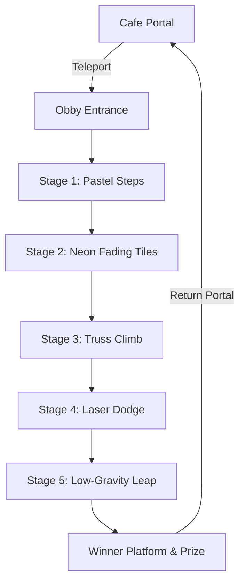

# Implementation Plan - Dynamic 5-Stage Sky Obby

This plan outlines the implementation of a fully scripted, 5-stage "Sky Obby" next to our Hangout Cafe. To preserve the cafe's aesthetics, the obby will be built far away in the sky (e.g., at coordinate `X = 500, Y = 100, Z = 500`) and connected via the existing `TeleportService`.

---

## User Review Required

Please review the proposed design of the Obby and the reward for completion.

> [!IMPORTANT]
> The obby will be generated **programmatically** when the server starts. This means you do not need to build it manually in Roblox Studio! Any modifications to the stages can be tweaked directly in the script.

---

## Open Questions

1. **Obby Difficulty:** Should the stages be easy/forgiving (so player experience remains relaxing) or moderately challenging?
2. **Rewards:** Currently, we propose awarding a **special speed coil tool** (giving a speed boost) and a temporary chat tag (e.g. `[Obby Champ]`) upon completion. Would you like a different prize?

---

## Proposed Changes

### Cafe Core

#### [NEW] [ObbyService.lua](file:///C:/Users/EI/.gemini/antigravity/scratch/metro-hangout/src/server/ObbyService.lua)
Create a new server-side service responsible for:
1. **Map Generation:** Spawning the obby start base, stages, checkpoints, and final platform at `Vector3.new(500, 100, 500)`.
2. **Teleport Portals:** Spawning `Teleport2_Start` near the cafe spawn and `Teleport2_End` at the Obby entrance (hooked up automatically by the existing `TeleportService`).
3. **Checkpoint System:** Storing player checkpoint states (`ObbyCheckpoint` attribute). When players die, they will automatically respawn at their furthest active checkpoint.
4. **Interactive Mechanics:**
   * **Fading Tiles (Stage 2):** Disappearing neon steps.
   * **Kill Lasers (Stage 4):** Red neon beams that kill players on contact.
   * **Low-Gravity (Stage 5):** Automatically lowering player gravity when entering the stage.
5. **Reward Delivery:** Awarding a custom **Speed Coil** and chat tag upon reaching the final portal.

#### [MODIFY] [init.server.lua](file:///C:/Users/EI/.gemini/antigravity/scratch/metro-hangout/src/server/init.server.lua)
Require and initialize `ObbyService` alongside other server services.

---

## Stages Overview

1. **Stage 1 (Pastel Steps):** Friendly multi-colored rising platforms to ease players in.
2. **Stage 2 (Fading Tiles):** Neon platforms that fade and lose collision shortly after being stepped on, then reappear.
3. **Stage 3 (Truss Climb):** Vertical climbing challenge with trusses and narrow beams.
4. **Stage 4 (Laser Dodge):** Moving or static red lasers that reset player health on contact.
5. **Stage 5 (Low-Gravity Leap):** Spaced-out floating clouds where gravity is reduced, allowing giant, slow jumps.

---

## Verification Plan

### Automated & Manual Verification
1. **Teleport Verification:** Ensure jumping into the Portal near the Cafe teleports you to the Obby.
2. **Checkpoint Test:** Fall into the void from Stage 3 and verify you respawn at Checkpoint 2 (not back at the cafe).
3. **Laser Test:** Walk into a red laser to confirm it resets health.
4. **Completion Test:** Touch the final golden pad, verify you receive the Speed Coil, and get teleported back to the Cafe.
